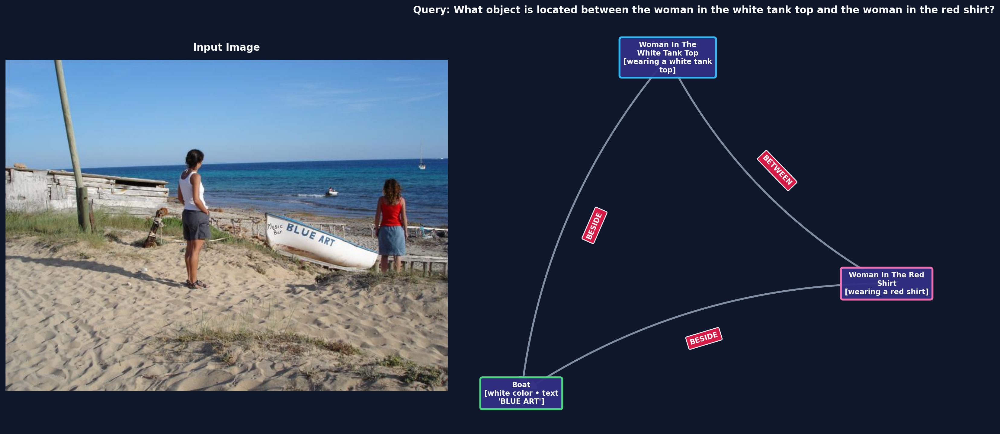

# Grounded Spatial VQA & Visual Scene Graph

A spatial reasoning Visual Question Answering (VQA) and scene graph pipeline built around `Qwen/Qwen2.5-VL-3B-Instruct`, paired with a high-contrast NetworkX scene graph visualizer and empirical Kaggle Tesla T4 ablations.



## Key Components

- **[`qwen_spatial_vqa.py`](qwen_spatial_vqa.py)** — Production `SpatialVQAPipeline` running `Qwen/Qwen2.5-VL-3B-Instruct` with Physical Contact Tracing Chain-of-Thought and Grounded Scene Graph JSON output.
- **[`visualize_scene_graph.py`](visualize_scene_graph.py)** — Renders a dark-themed side-by-side visualization of any source image alongside the model's directed scene graph (`plot_scene_graph` using `networkx` and `matplotlib`).
- **[`final_architecture.md`](final_architecture.md)** — Architecture specification and prompt engineering notes.
- **[`report.md`](report.md)** & **[`summary.md`](summary.md)** — Earlier model evaluation notes and summaries.
- **Benchmark & Dataset Utilities** — [`generate_spatial_questions.py`](generate_spatial_questions.py), [`convert_scene_graphs.py`](convert_scene_graphs.py), [`evaluate_spatial_benchmark.py`](evaluate_spatial_benchmark.py), [`spatial_reasoning_pipeline.py`](spatial_reasoning_pipeline.py), [`compare_qwen_models.py`](compare_qwen_models.py), [`prepare_dataset.py`](prepare_dataset.py), [`prepare_kaggle_benchmark.py`](prepare_kaggle_benchmark.py), [`build_and_push_24_benchmark.py`](build_and_push_24_benchmark.py).

## 24-Query Kaggle Tesla T4 Ablation Benchmarks

All four prompt architectures were evaluated live on an Nvidia Tesla T4 GPU (`torch.float16`, deterministic greedy decoding, `repetition_penalty=1.05`) across 24 unique spatial reasoning queries (elevation, betweenness, and lateral orientation) from the Kaggle dataset `tanishqgarg2007/spatial-benchmark-24-images`:

| Pipeline Variant | Directory | Valid JSON | Correct Answers | Mean Latency | Mean Tokens |
| :--- | :--- | :---: | :---: | :---: | :---: |
| **Pure Contact CoT (No Scene Graph, No Boxes)** | [`kaggle_run_24_purecot/`](kaggle_run_24_purecot/) | 24 / 24 (100%) | **13 / 24 (54.2%)** | **6.86 s** | **115.2** |
| **Contact CoT + Scene Graph (No Boxes)** | [`kaggle_run_24_nobox/`](kaggle_run_24_nobox/) | 24 / 24 (100%) | 12 / 24 (50.0%) | 14.95 s | 288.8 |
| **Contact CoT + Scene Graph + 2D Boxes** | [`kaggle_run_24/`](kaggle_run_24/) | 24 / 24 (100%) | 12 / 24 (50.0%) | 18.92 s | 361.6 |
| **Staged Focal-First CoT + Scene Graph** | [`kaggle_run_24_newcot/`](kaggle_run_24_newcot/) | 24 / 24 (100%) | 10 / 24 (41.7%) | 15.05 s | 290.1 |

## Quick Usage

### 1. Run Spatial VQA Inference

```bash
python qwen_spatial_vqa.py --image path/to/image.jpg --query "What object is located between the motorcycle and the broom?"
```

### 2. Visualize Grounded Scene Graph JSON

```bash
python visualize_scene_graph.py --image path/to/image.jpg --index 1 --output scene_graph_dark_side_by_side.png
```

> **Note:** Raw image datasets (`images/` and Kaggle upload copies) and `.ENV` files are excluded via `.gitignore`.
